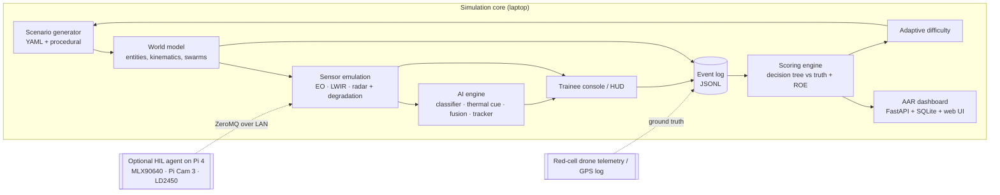

# TRINETRA: Development Plan

**AI-Enabled Drone & Counter-Drone Threat Simulation Trainer**
Smart India Hackathon 2026 · PS **SIH26247** · Team **SkyNetics**
Status: draft v0.1, 20 Oct 2026

This is the starting point for building TRINETRA. It covers:
- what the problem statement asks for
- what we build first
- how the existing SkyNetics drone code and hardware fit in
- how work is split across the team

Read it before writing code. Update it whenever a decision changes.

---

## 1. The problem statement

| Field | Value |
|---|---|
| PS ID | SIH26247 |
| Title | AI-Enabled Drone & Counter-Drone Threat Simulation Trainer |
| Organisation | Ministry of Defence, Defence Services Staff College (DSSC) |
| Category | **Software** |
| Theme | Robotics and Drones |

> These details come from unofficial mirrors of the SIH 2026 list. Confirm the exact wording on sih.gov.in and paste it here.

**What the brief asks for:** a software simulator that trains personnel to detect, classify and respond to single-drone and swarm threats. It must cover:
- day and night
- urban and rural terrain
- degraded-sensor conditions

**Expected outcomes**, which are our acceptance checklist:

- [ ] Desktop (or VR) simulator with **scripted and procedurally generated scenarios**
- [ ] **Decision-tree scoring** on detection time, classification accuracy and engagement (response) decisions
- [ ] **After-action review (AAR) dashboard** tracking individual and unit performance across sessions
- [ ] **Difficulty adjustment and scenario randomisation** to prevent rote learning
- [ ] Runs at unit level with **minimal specialised hardware**

**Scope boundary (non-negotiable):** TRINETRA is a training simulator only.
- No real weapon, jammer, EW or C2 interfaces.
- No real targeting.
- Responses are abstract decisions that get scored.
- Synthetic, non-operational scenarios only.

Say this in the pitch, and keep it true in the code.

---

## 2. What we are building (one paragraph)

The trainer is a laptop application. A scenario engine generates hostile and neutral air activity: quadcopters, hexacopters, fixed-wing UAVs, FPV drones, swarms, birds and friendlies. A sensor-emulation layer renders what a counter-drone post would see:
- an **EO camera** view
- a **thermal (LWIR)** view
- a **radar** plan view

Each view degrades on demand: night, fog, glare, RF jamming, sensor dropout. The trainee works a HUD console to detect, classify, decide and respond. Every action is time-stamped into an event log, and a scoring engine compares it with ground truth and the rules of engagement (ROE). An AAR dashboard replays the run and tracks progress, and the next scenario is tuned to the trainee's level.

Optional hardware-in-the-loop (HIL) mode swaps one or more emulated sensors for the real SkyNetics sensors.

---

## 3. How the SkyNetics drone fits

The PS is **Software**, and it asks for **minimal special hardware**, so the drone is **never required** to run the trainer. Its value lies in three places:
- the **software engine** we already wrote
- **realism**: sensor models tuned on real sensors
- an **optional live demo**

### 3.1 Code reuse map

The rescue-drone code lives in its own repo (`SkyNetics-RAS-drone`, locally `C:\projects\drone`). TRINETRA does **not** import it. The code has known issues (section 10), so treat it as a reference implementation: copy each module in when a phase needs it, fix it, and add tests.

| Existing module (rescue-drone repo) | What it does today | Role in TRINETRA | Change needed |
|---|---|---|---|
| `sensors/thermal_camera.py` → `ThermalCamera`, `build_rescue_colormap()` | MLX90640 read, AGC, colour map, synthetic frames | **IR sensor model** (AGC + palette) and HIL thermal source | Split into `EmulatedIR` (temperature map in) and `LiveIR` (MLX90640 in), with a shared AGC/palette |
| `sensors/rgb_camera.py` → `RGBCamera` | Pi Cam 3 capture, PDAF workaround, watchdog | HIL EO source | Wrap as `LiveEO`; emulated EO is new |
| `sensors/ld2450_radar.py` → `LD2450Sensor`, `RadarTarget` | 24 GHz frame parser, presence model | HIL radar source + **radar data model** (range, bearing, speed) | Verify the coordinate decoding (section 10); emulated radar is new |
| `sensors/flight_controller.py` → `FlightController` | MAVLink telemetry (read-only) | **Ground truth** for the red-cell drone (GPS track) | Reuse as is; add log replay |
| `ml/models.py` → `YOLODetector` | ONNX YOLOv8n person detector, 320 px, CPU | **Drone / bird / aircraft classifier** | Retrain on drone classes (section 7); keep the loader and pre/post-processing |
| `ml/models.py` → `AnomalyDetector` | Hot-blob detector on raw temperatures | Thermal cue for small or far drones | Retune thresholds for hot motors against a cold sky |
| `ml/models.py` → `SensorFusion` | Late fusion of YOLO + thermal + radar | AI assist (Guided mode) and **AI benchmark** for scoring | Fuse in world coordinates (bearing/range), not image IoU |
| `ml/models.py` → `HumanTracker`, `_Track` | SORT: Kalman + Hungarian, re-ID graveyard | **Track IDs** for every target | Rename to `Tracker`; add a world-coordinate state |
| `ml/detection.py` → `Detection` | Shared dataclass | Same | Add `class_name`, `bearing_deg`, `range_m` |
| `display/osd.py` → `OSDRenderer` | Telemetry HUD, corner-bracket boxes | **Trainee HUD** and drone-operator OSD | Render text once per frame (performance) |
| `display/rescue_display.py` → `RescueDisplay` | Views, PiP, radar scope, snapshots | **Console shell** (view switching, PiP, input) | Radar scope must plot the real bearing/range |
| `pipeline/detection_pipeline.py` → `DetectionPipeline`, `FrameData` | Per-frame orchestration | **Simulation tick loop** | Driven by the scenario clock, not the sensor rate |
| `main.py` (inference thread + 30 fps display loop, `--demo`) | Decoupled threads, synthetic mode | App entry point | Add `--scenario`, `--hil`, `--difficulty` |

### 3.1.1 Port verdicts (modules reviewed 20 Oct 2026)

| Module | Verdict | Reason |
|---|---|---|
| `ThermalCamera._to_visual` (percentile AGC + EMA) | **Ported** → `sensors/ir.py` `PercentileAGC` | Sound. Dropped the side effect of writing limits into the global config. |
| `build_rescue_colormap()` | **Ported** as the `rescue` palette | White-hot, black-hot and ironbow added; white-hot is the default for drones against sky. |
| `HumanTracker` / `_Track` | **Rewritten** → `ai/tracker.py` | Streak bug (section 10, item 3a); image-box IoU replaced by world-coordinate Mahalanobis gating; IDs per tracker instead of a class-level global. |
| `_assign` (Hungarian + greedy fallback) | **Ported** (pattern) | Correct. |
| `_nms`, `_iou_matrix` | Port in Phase 2 with the classifier | Correct and vectorised. |
| `YOLODetector` | Port in Phase 2, with a fix | Letterboxing is right, but it reads only class 0 (`pred[:, 4]`); multi-class needs an argmax over `pred[:, 4:]`. Drop the Pi-specific subprocess import check. |
| `AnomalyDetector` | Rewrite in Phase 2 | Rejects anything above 45 °C, which removes drone motors (45–60 °C); human-shape filter does not fit drones. |
| `SensorFusion` | Rewrite in Phase 2 | Image IoU across different cameras (item 4). |
| `OSDRenderer`, `RescueDisplay` | Decide with the console choice | Not reviewed yet. |

### 3.2 Hardware roles (all optional)

We currently own the Pi 4, MLX90640, Pi Camera 3, BotWing F722 and the analog VTX. **We do not yet have the HLK-LD2450 radar** (≈ ₹1,400).

| Role | Hardware | Used for |
|---|---|---|
| **Sensor post (HIL)** | Pi 4 + MLX90640 + Pi Cam 3 (+ LD2450 later) on a tripod, streaming to the trainer laptop over local Ethernet/Wi-Fi | Live thermal/EO feed in the console; recording real signatures to tune the emulators |
| **Red-cell threat drone** | SkyNetics airframe + F722 + VTX, flown by the instructor (Pi payload removed and used as the sensor post) | A real drone for the trainee to detect at short range; its GPS log is the ground truth |
| **Drone-operator station** | The VTX feed + our OSD | Drone-side and HADR training modes |

> We have **one** Pi 4, so the sensor post and the drone payload cannot run at the same time. In red-cell mode the drone flies with only the FC and VTX.

**Ground truth in red-cell mode** has two options:
- **Phase 1:** sync the FC's GPS/blackbox log with the trainer's event log after the flight.
- **Phase 2:** a live telemetry radio (e.g. a SiK pair) feeding `FlightController`.

### 3.3 Honest hardware limits (keep the pitch consistent with these)

| Sensor | Spec | Realistic drone-detection range | Consequence |
|---|---|---|---|
| MLX90640 (55°) | 32×24 px, ≈1.7°/px, 4–8 Hz used | ~5–15 m (hot motors against a cold sky, sub-pixel) | HIL thermal is a **short-range demo and calibration tool**; long-range LWIR is emulated |
| Pi Camera 3 | 12 MP, ~75° diagonal | Tens of metres at full resolution with tiling; a few pixels at 640×480 | EO HIL works at short to medium range; tile the image for small targets |
| HLK-LD2450 | 24 GHz, human-presence radar, ≤3 targets, single-digit metres | A few metres | **Not a counter-drone radar.** Long-range radar is emulated; LD2450 shows the live radar pipeline only |

The trainer's realism comes from emulated sensors whose noise, resolution, AGC and dropout behaviour we copy from real hardware. It does not come from the hardware's range.

---

## 4. Architecture



**Core rule:** the **world model is the single source of truth**. Sensors, the AI and the trainee each produce their own view of it, and scoring compares each view with the truth. This also removes the cross-sensor registration problem the rescue drone had, because every sensor is generated from the same world coordinates.

---

## 5. Proposed layout

TRINETRA is its own repo (locally `C:\projects\SIH`) with a top-level package `trinetra/`. Rescue-drone modules are copied in and ported when needed (section 3.1); there is no import dependency on that repo.

```text
trinetra/
├── app.py                  # entry: --scenario, --difficulty, --hil, --headless
├── config.py               # dataclass config (pattern from ../config.py)
├── core/
│   ├── world.py            # entities, kinematics, 10 Hz sim clock
│   ├── behaviours.py       # waypoint, loiter, attack-run, boids swarm, evasive
│   ├── scenario.py         # YAML loader + procedural generator (seeded)
│   └── events.py           # event log schema + JSONL writer
├── sensors/
│   ├── base.py             # Sensor interface: initialize() / read(world, t) / release()
│   ├── eo.py               # pinhole projection + sprite compositing on photo backgrounds
│   ├── ir.py               # temperature map -> LWIR sensor model -> palette (from ThermalCamera)
│   ├── radar.py            # range/bearing/Doppler, Pd vs RCS, clutter, jamming dropouts
│   ├── degrade.py          # fog, night, glare, noise, tearing, frame drops
│   └── hil.py              # ZeroMQ subscriber for live Pi sensors
├── ai/
│   ├── classifier.py       # ported YOLODetector, drone classes
│   ├── thermal_cue.py      # ported AnomalyDetector
│   ├── fusion.py           # bearing/range association
│   └── tracker.py          # ported SORT tracker
├── console/
│   ├── hud.py              # ported OSDRenderer
│   ├── views.py            # EO / IR / radar PPI / PiP (from RescueDisplay)
│   └── input.py            # select track, classify, choose response
├── scoring/
│   ├── rubric.py           # metrics + weights
│   ├── roe.py              # decision trees per threat type
│   └── difficulty.py       # rating update -> next scenario parameters
├── aar/
│   ├── api.py              # FastAPI: sessions, runs, metrics
│   ├── store.py            # SQLite
│   └── web/                # dashboard (React + Recharts; Streamlit is fine for the MVP)
├── hil_agent/
│   └── agent.py            # runs on the Pi: reads sensors, publishes frames over ZeroMQ
├── scenarios/              # *.yaml scenario packs
├── assets/                 # backgrounds, drone sprites, fonts
└── tests/
```

---

## 6. Key specifications

### 6.1 Scenario file

```yaml
id: SCN-07-forward-post
seed: 2647
terrain: mountain            # urban | rural | mountain | coastal
time_of_day: dusk            # day | dusk | night
weather: { fog: 0.3, wind_mps: 6 }
degradation:
  - { at_s: 40, sensor: eo, kind: jamming, duration_s: 8 }
post: { lat: 34.1658, lon: 77.5841, sensors: [eo, ir, radar] }
roe: standard-forward-post
entities:
  - { id: UAV-01, class: quad,  hostile: true,  spawn_s: 5,  path: attack_run, from_bearing: 40, range_m: 1800, speed_mps: 14 }
  - { id: SW-A,   class: quad,  hostile: true,  spawn_s: 30, swarm: { size: 5, behaviour: boids, split_at_s: 55 } }
  - { id: BIRD-1, class: bird,  hostile: false, spawn_s: 12, path: wander }
  - { id: FRND-1, class: hexa,  hostile: false, spawn_s: 20, path: patrol, iff: true }
```

Procedural mode generates the same structure from `difficulty` and `seed`.

### 6.2 Event log (JSONL, one line per event)

```json
{"t": 12.40, "type": "truth_enter_coverage", "truth_id": "UAV-01", "sensor": "radar"}
{"t": 15.95, "type": "trainee_select", "track_id": 3, "truth_id": "UAV-01"}
{"t": 17.10, "type": "trainee_classify", "track_id": 3, "label": "quad", "hostile": true}
{"t": 19.80, "type": "trainee_respond", "track_id": 3, "action": "alert_qrt"}
{"t": 19.81, "type": "ai_assessment", "track_id": 3, "label": "quad", "conf": 0.93}
```

Every score, replay and chart is computed from this log. Never score from UI state.

### 6.3 Scoring (weights match the pitch deck; instructors can edit them)

| Metric | Weight | Definition |
|---|---|---|
| Time to detect | 30% | `trainee_select.t − truth_enter_coverage.t`, normalised per difficulty |
| Classification | 25% | label and hostile flag vs truth |
| Response per ROE | 30% | chosen action vs the ROE decision tree for that threat state |
| False alarms & misses | 15% | penalty per hostile declared on a bird or friendly, and per hostile never actioned |

Response actions are abstract and simulated: `monitor`, `alert_qrt`, `hand_off`, `simulated_soft_kill`, `simulated_hard_kill`, `ignore`. A ROE tree example:

```text
hostile? ── no ──> ignore / monitor
   └ yes ─ inside 1 km? ── no ──> monitor + alert_qrt
              └ yes ─ approaching protected asset? ── yes ──> simulated_soft_kill (simulated_hard_kill if soft fails)
                                                    └ no ───> hand_off
```

### 6.4 Adaptive difficulty

Keep an Elo-style rating per trainee. After each run, update the rating from the score, then map it to generator parameters:
- number of drones: 1 → 20
- speed
- decoy ratio (birds, friendlies)
- night/fog probability
- jamming frequency
- sensor-dropout severity

Levels: **Guided** (AI hints on) → **Standard** → **Stress** → **Swarm**.

### 6.5 Sensor emulation notes

- **IR:** each entity carries a temperature profile: motors 45–60 °C, battery 30–40 °C, body near ambient, birds about 40 °C at the core. Rasterise to a temperature map, then apply our LWIR model:
  - area downsample to sensor resolution
  - temporal noise
  - column fixed-pattern noise
  - blur
  - percentile AGC with EMA smoothing, ported from `ThermalCamera`
  - ironbow / white-hot palette

  The deck images were made this way. Their prototype script is `make_images.py` in this session's scratch folder; copy it in as `trinetra/tools/signature_prototype.py` if it's useful.
- **EO:** use a pinhole camera at the post. Composite segmented drone sprites onto real background photos, scaled by range, then add haze, blur, motion smear and night gain noise.
- **Radar:** for each entity, compute range, bearing and radial speed. Use a detection probability that depends on RCS and range, Gaussian range/bearing error, Poisson clutter false alarms, and jamming windows that raise the noise floor and drop detections. Keep the output format compatible with `RadarTarget` so the HIL LD2450 path plugs into the same interface.

---

## 7. AI model plan

- **Classes:** `quad`, `hexa`, `fixed_wing`, `fpv`, `bird`, `aircraft`. Merge some classes if the data is thin.
- **Data:**
  - Anti-UAV (RGB + thermal tracking benchmark)
  - Drone-vs-Bird challenge data
  - our own synthetic renders from the emulator (free labels)
  - a small set of real clips of our drone, both EO and MLX90640
- **Model:** YOLOv8n at 320 px (match the existing `YOLODetector` input). Export to ONNX and run on CPU through the existing loader. Tile the frame for small targets.
- **Evaluation:** a held-out real clip set. Report mAP@0.5, per-class recall and false alarms per minute. Put these numbers in the pitch once we have them.
- **Owner:** Vishal (Model Training).

---

## 8. Milestones

| Phase | Target | Deliverable | Definition of done |
|---|---|---|---|
| **0 · Setup** | Week 1 | `trinetra/` skeleton, config, event log, CI running `pytest` | `python -m trinetra.app --scenario scenarios/smoke.yaml --headless` writes a valid JSONL log |
| **1 · MVP (college round demo)** | Weeks 2–3 | World + 3 emulated sensors + HUD + scoring for 1 drone and 1 bird; 3 scripted scenarios | A trainee plays SCN-01..03 end to end and gets a score breakdown |
| **2 · Brief coverage** | Weeks 4–6 | Swarms, procedural generator, all degradations, AAR dashboard, adaptive difficulty, retrained classifier | Every checkbox in section 1 is ticked |
| **3 · HIL + polish** | Weeks 7–8 | Pi HIL agent (thermal + EO), red-cell flight with GPS-log sync, drone-operator/HADR mode | Live demo: real drone in the console, scored against GPS truth |
| **Finale (36 h)** | National round | Problem-owner feedback, new scenario packs, UX polish | Stable demo with no crashes over 30 minutes |

Week 1 starts 20 Oct 2026. Set real dates once the SIH 2026 timeline is confirmed.

---

## 9. Team split

SIH needs **6 members, including at least one woman**. Fill in the two open slots.

| Member | Primary ownership | Secondary |
|---|---|---|
| Asronal (Hardware & Integrations) | `hil_agent/`, sensor post, red-cell drone, telemetry and ground truth | Sensor-model calibration recordings |
| Anuj D (Software) | `core/`, `console/`, app loop, event log | Code review, releases |
| Vishal (Model Training) | `ai/` classifier dataset, training, ONNX export, evaluation | `ai/thermal_cue.py` tuning |
| Akilan S (Hardware Assembly) | Tripod sensor post (power, enclosure, mounts), drone prep, range-day safety checklist | Asset capture (photos, sprites) |
| Member 5 (TBD) | `aar/`: FastAPI, SQLite, dashboard | Charts in the pitch |
| Member 6 (TBD) | `scoring/` + `scenarios/` (ROE trees, scenario packs) | Pitch deck, docs, demo script |

---

## 10. Check these in the latest rescue-drone code before porting

These came from a review of the version in this repo. Your latest code may already fix some of them.

1. **LD2450 coordinate decoding:** the protocol uses sign-magnitude values, and the parser may read them as two's-complement. Verify against raw bytes before trusting `RadarTarget` positions.
2. **Two inconsistent thermal thresholds** (`AnomalyDetector` vs `ThermalIsolator`): use one shared implementation.
3. **Tracker confirms after 1 hit** at a 0.10 YOLO confidence threshold, so false tracks inflate counts. Use `min_hits` 2–3.
   - 3a. **Raising `min_hits` alone does not work** (found 20 Oct 2026): `_Track.predict()` decrements `streak` every frame and `update()` increments it, so a track matched every frame stays at `streak = 1`. With `min_hits >= 2`, no track confirms after the first frames. Count hits within a window instead (TRINETRA's tracker uses M-of-N). Worth fixing in the rescue drone too.
4. **No cross-sensor registration** in fusion, which used image IoU across different cameras. Fuse in bearing/range (section 4).
5. **Recording FPS mismatch**: the writer FPS is not the render FPS, so recordings play in slow motion.
6. **Radar scope** draws targets relative to the sweep, not at their real bearing.
7. **No unit tests.** Add tests for NMS, IoU, the Kalman update, the radar parser, scoring and the ROE trees first.

---

## 11. Getting started

See [README.md](README.md) for setup and run commands. `requirements.txt` lists only what the current phase needs; uncomment the later-phase packages as their modules land.

**Phase 0 tasks** (all done, 20 Oct 2026; 48 tests passing):

- [x] `core/events.py`: event schema + JSONL writer/reader + schema tests
- [x] `core/world.py`: entity model + 10 Hz clock; `core/behaviours.py`: straight line and attack run
- [x] `scenarios/smoke.yaml` + `core/scenario.py` loader
- [x] `sensors/radar.py`: emulated radar; `RadarPlot` has the LD2450 `RadarTarget` fields and converts live LD2450 targets
- [x] `app.py --headless`: runs smoke.yaml for 60 s and writes the log
- [x] `scoring/rubric.py`: time-to-detect, tested on a hand-written log
- [ ] CI: `.github/workflows/tests.yml` is ready; it runs once the repo is pushed to GitHub

**Phase 0 decisions worth knowing:**
- Coverage (`truth_enter_coverage`) means "detectable at Pd ≥ 50 % in clear conditions". Jamming does not delay it, so degraded runs are harder rather than excused.
- Time to detect: selecting a hostile before it enters coverage counts as 0 s. Hostiles that never enter coverage are not scored.
- Detection time targets get *more* lenient at harder levels (`DETECT_TARGETS_S` in `scoring/rubric.py`), so scores stay comparable as difficulty rises. Instructors can tune them.
- The event log rejects unknown response actions, so only the simulated actions in `core/catalog.py` can ever be recorded.

**Phase 1 progress** (non-console parts, 20 Oct 2026; 72 tests passing):

- [x] `sensors/ir.py`: emulated LWIR (sky/ground model, per-class thermal signatures, sub-pixel targets, fog, noise, dropout), ported AGC + palettes, plus detail enhancement so small drones stay visible over hot ground. Each frame also reports where each entity landed: free labels for classifier training.
- [x] `ai/tracker.py`: world-coordinate tracker on radar plots, M-of-N confirmation. Tracks drop under jamming and come back with a new ID afterwards, so the trainee has to re-acquire.
- [x] `scoring/roe.py` + `score_run()`: all four rubric metrics, ROE tree from section 6.3, plain-language notes for the AAR ("UAV-01: simulated_hard_kill at 61.0 s … earned 0.50").
- [x] Event log: `truth_state` at 1 Hz (ROE context and AAR replay), `track_confirm` / `track_drop`; trainee events carry the simulator-resolved `truth_id`.
- [x] Trainee console: OpenCV (decided 20 Oct 2026; browser UI can follow in Phase 2). Radar scope, thermal view cued to the selected track with a zoom inset, briefing screen, keyboard/mouse actions, score screen with notes. `core/session.py` runs one training run for both the console and the headless runner.
- [x] Simulated engagement outcomes: soft kill 70 %, hard kill 90 %, only within 1 km; a kill removes the target and is logged as `neutralised_simulated`.
- [x] Scenarios SCN-01 (day, single quad), SCN-02 (dusk, FPV among friendly and birds, radar dropout), SCN-03 (night, recce fixed-wing + quad under jamming, IR noise)
- [x] Tracker fix: two-stage association (confirmed tracks pick plots first); before it, a tentative track born beside a target could take over its plots and change its ID mid-run.
- [x] Thermal render 382 → 38 ms per frame (background at sensor resolution, supersampled patch per target only)
- [ ] `sensors/eo.py`: emulated EO camera
- [ ] Playtest SCN-01..03 with a teammate and tune difficulty (definition of done for Phase 1)

---

## 12. Demo script for judges (about 5 minutes)

1. **Guided run:** one quadcopter by day; the AI hints; the trainee scores high. *Shows the basic loop.*
2. **Stress run:** dusk, fog, a bird decoy and a 5-drone swarm; EO jams mid-run and the radar track holds. *Shows degraded sensors and cross-cueing.*
3. **AAR:** replay the stress run; show where time was lost and the trend across sessions. *Shows the dashboard and objective scoring.*
4. **Live HIL clip:** the real drone in the thermal view at short range, with the GPS track overlaid. *Shows our sensor models come from real hardware.*
5. **HADR mode** (one slide): the same engine finding heat signatures in snow. *Shows dual use.*

---

## 13. Open decisions

- [ ] Confirm the PS wording and category on sih.gov.in
- [x] Trainee console: OpenCV window for Phase 1 (decided 20 Oct 2026); revisit a browser UI with the AAR dashboard in Phase 2
- [ ] AAR stack for the MVP: Streamlit now, React later, or React from the start
- [ ] Telemetry radio for live red-cell ground truth (budget)
- [ ] Buy the HLK-LD2450 (≈ ₹1,400) now or after the MVP
- [ ] Names and roles for members 5 and 6
